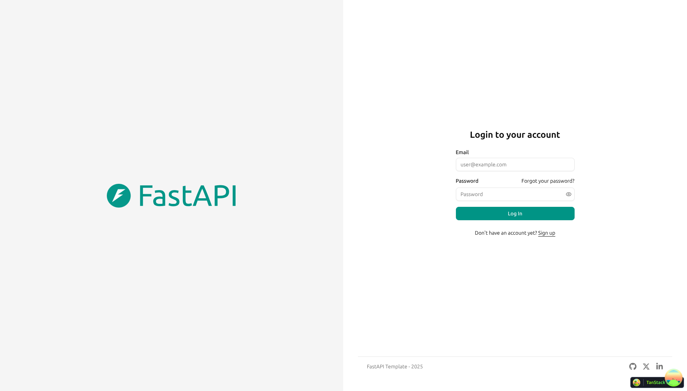
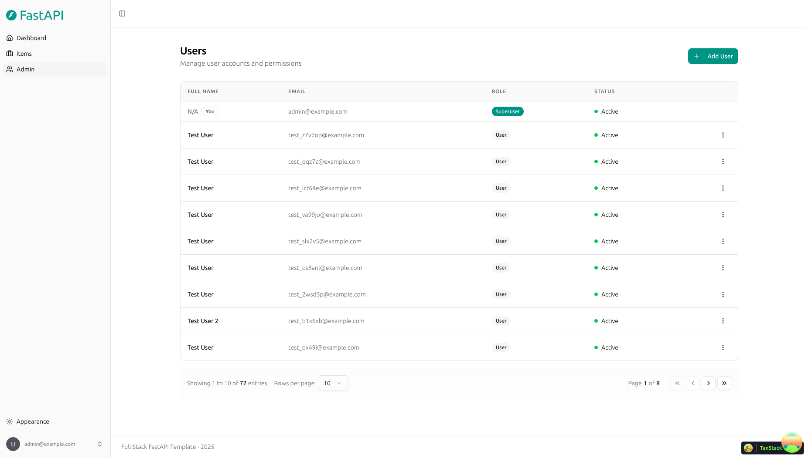
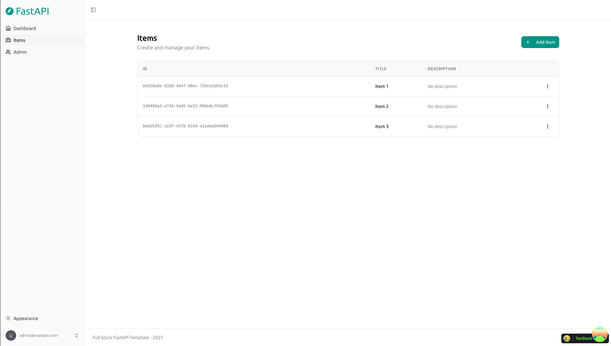
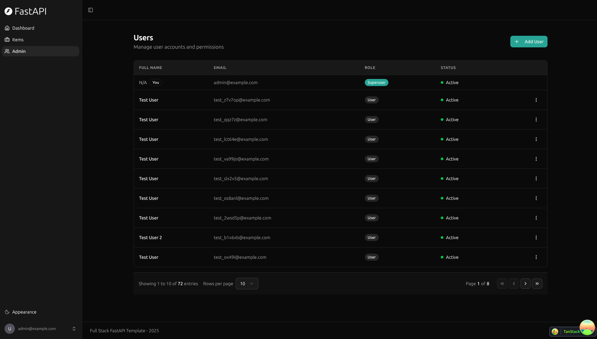
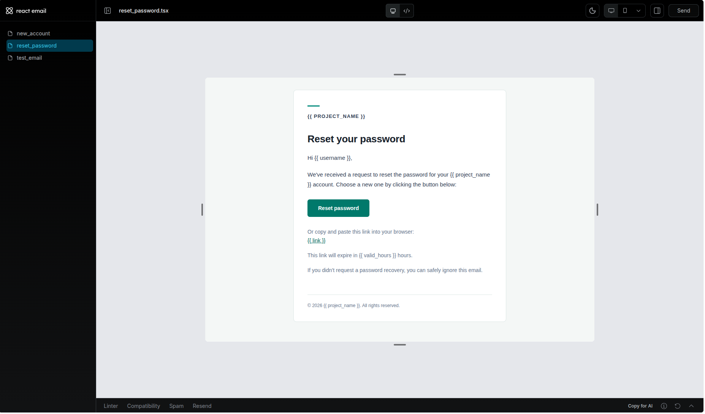
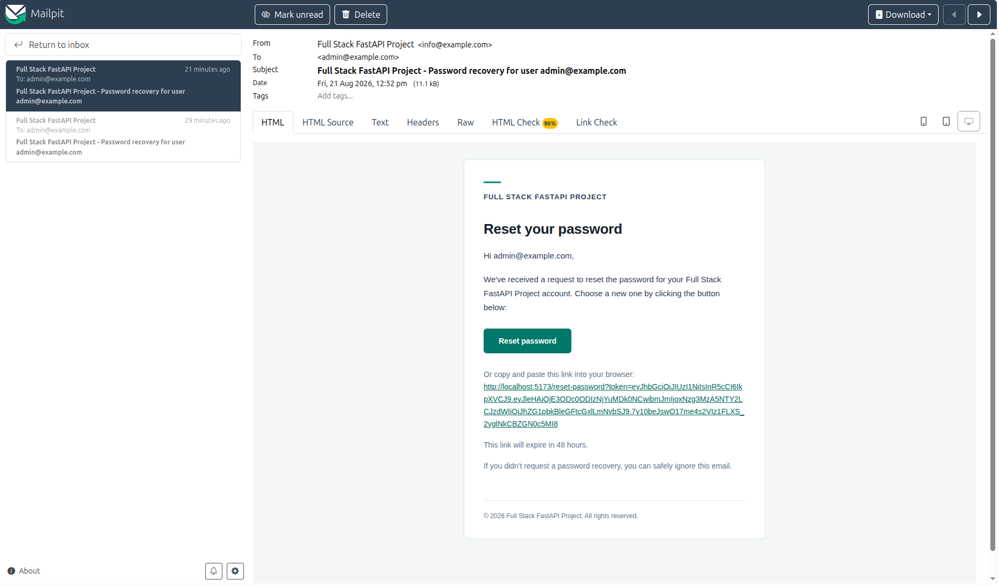
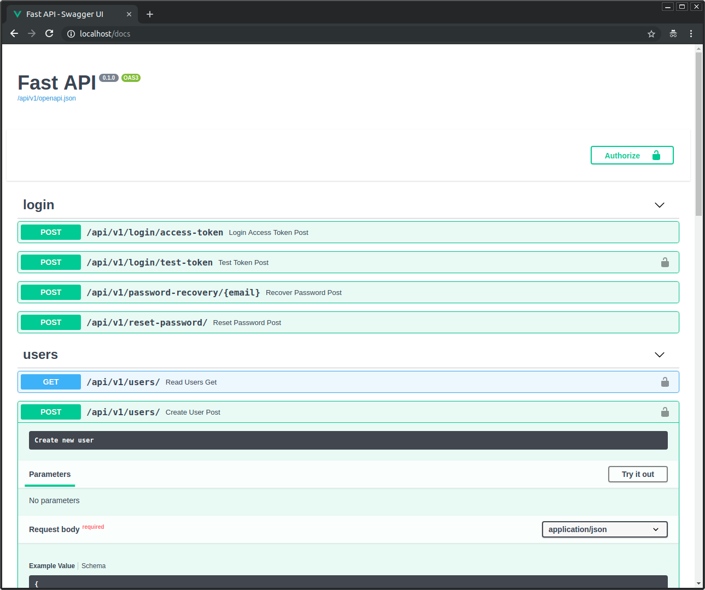

# Full Stack FastAPI Template

[](../../actions/workflows/test-docker-compose.yml)
[](../../actions/workflows/test-backend.yml)

## Role-based access control

This repository implements the Ender Turing test task ([TASK.md](./TASK.md)). The template's single `is_superuser` flag is replaced by three access levels:

| | Admin | Manager | Member |
|---|:-:|:-:|:-:|
| Own profile, password and items | ✓ | ✓ | ✓ |
| View users | ✓ | ✓ | – |
| View metrics | ✓ | ✓ | – |
| Create, edit and delete users; change their role and active status | ✓ | – | – |
| Other users' items; admin utilities (test email, recovery-email preview) | ✓ | – | – |

- **Rules:** `backend/app/core/permissions.py` maps each role to its permissions, and endpoints are guarded with `require_permission(...)` from `backend/app/api/deps.py`. Self-registration always creates members. Admins can't change their own role, deactivate themselves or delete themselves, so at least one admin always remains.
- **Existing sessions:** the JWT only identifies the user. The role and active status are read from the database on every request, so changes apply immediately. An invalid session (bad token, deleted or deactivated user) gets `401`; a missing permission gets `403`.
- **Frontend:** `GET /api/v1/users/me` returns the user's `permissions`. Navigation, buttons and route guards use them, and opening a page you can't access shows "Access denied".
- **Migration:** existing superusers become admins and everyone else becomes a member; nobody becomes a manager. Downgrading turns admins back into superusers.
- **API change:** `is_superuser` is replaced by `role` (`admin`, `manager` or `member`) in the user schemas.

### Try the three roles locally

Set up the project as described in [development.md](./development.md), then create the demo accounts:

```bash
cd backend
uv run python app/seed_demo_users.py
```

With the Docker Compose stack, run `docker compose exec backend python app/seed_demo_users.py` instead.

| Email | Role |
|---|---|
| `admin@example.com` (`FIRST_SUPERUSER`) | Admin |
| `manager@example.com` | Manager |
| `member@example.com` | Member |

All three use `FIRST_SUPERUSER_PASSWORD` from `.env` (`changethis` by default). The backend tests delete all users from the local database when they finish, so run the seed script again after running them.

## Technology Stack and Features

- ⚡ [**FastAPI**](https://fastapi.tiangolo.com) for the Python backend API.
  - 🧰 [SQLModel](https://sqlmodel.tiangolo.com) for the Python SQL database interactions (ORM).
  - 🔍 [Pydantic](https://docs.pydantic.dev), used by FastAPI, for the data validation and settings management.
  - 💾 [PostgreSQL](https://www.postgresql.org) as the SQL database.
- 🚀 [React](https://react.dev) for the frontend.
  - 🧩 Built into the backend application and served by FastAPI on the same domain as the API.
  - 💃 Using TypeScript, hooks, [Vite](https://vitejs.dev), and other parts of a modern frontend stack.
  - 🎨 [Tailwind CSS](https://tailwindcss.com) and [shadcn/ui](https://ui.shadcn.com) for the frontend components.
  - 🤖 An automatically generated frontend client.
  - 🧪 [Playwright](https://playwright.dev) for end-to-end testing.
  - 🦇 Dark mode support.
- ☁️ [FastAPI Cloud](https://fastapicloud.com) for deployment.
- 🐋 [Docker Compose](https://www.docker.com) for local services and self-hosted deployment.
  - 📞 [Traefik](https://traefik.io) as a reverse proxy with automatic HTTPS.
- 🔒 Secure password hashing by default.
- 🔑 JWT (JSON Web Token) authentication.
- 📫 Email-based password recovery.
- ✉️ [React Email](https://react.email) for email templates.
- 📬 [Mailpit](https://mailpit.axllent.org) for local email testing during development.
- ✅ Tests with [Pytest](https://pytest.org).
- 🏭 CI (continuous integration) and CD (continuous deployment) based on GitHub Actions.

### Dashboard Login



### Dashboard - Admin



### Dashboard - Items



### Dashboard - Dark Mode



### React Email Templates



### Mailpit - Local Email Testing



### Interactive API Documentation



## How to Use It

Click the **Use this template** button at the top of this page to create a new repository.

## Backend Development

Backend docs: [backend/README.md](./backend/README.md).

## Frontend Development

Frontend docs: [frontend/README.md](./frontend/README.md).

## Deployment

FastAPI Cloud deployment: [deployment.md](./deployment.md).

Self-hosted deployment with Docker Compose: [deployment-docker-compose.md](./deployment-docker-compose.md).

## Development

General development docs: [development.md](./development.md).

This includes the local FastAPI and Vite workflow, Docker Compose services, `.env` configuration, and more.

## Release Notes

Check the file [release-notes.md](./release-notes.md).

## License

The Full Stack FastAPI Template is licensed under the terms of the MIT license.
